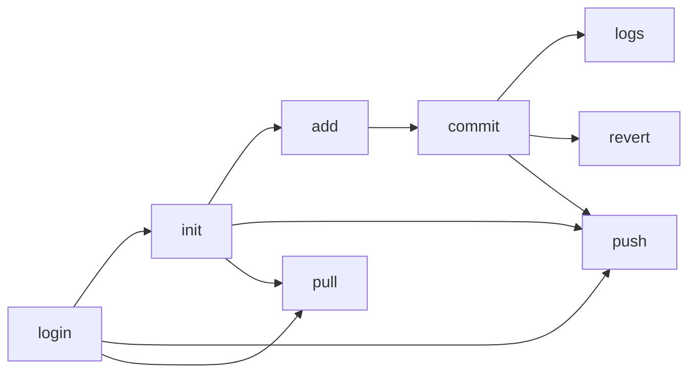

# SnapKeep — Project Documentation

A custom version-control CLI (`snapkeep`) built in TypeScript/Node.js. It mirrors a lightweight Git workflow locally (init → add → commit → log → revert) and syncs commits to a remote HTTP server backed by AWS S3.

---

## 1. Overview

| Item | Detail |
|------|--------|
| CLI binary | `snapkeep` (via `npm install -g .`) |
| Entry point | `src/server.ts` → compiled to `dist/server.js` |
| Router | [yargs](https://github.com/yargs/yargs) |
| Local store | `.snapkeep/` in the current working directory |
| Global auth config | `~/.snapkeep/config.json` |
| Remote server | `http://localhost:3000` (Express + Supabase + S3 — server code lives outside this repo) |

---

## 2. CLI Boot & Execution

```
Terminal → PATH → npm global symlink → dist/server.js → Node (shebang) → yargs → command handler
```

1. **Shebang** (`#!/usr/bin/env node`) lets the OS run the compiled file as a Node executable.
2. **dotenv** loads `.env` silently (`quiet: true`).
3. **yargs** parses `process.argv`, routes to one of nine commands, and requires exactly one command (`demandCommand(1)`).
4. **Context**: all repo operations use `process.cwd()` — the directory where the user runs `snapkeep`, not the CLI install path.

**Build & install:**
```bash
npm run build          # tsc → dist/
npm install -g .       # links `snapkeep` globally
```

---

## 3. Local Repository Layout

```
<project-root>/
├── .snapkeepignore       # ignore rules for `add`
├── .snapkeep/
│   ├── config.json       # { "name": "<folder-name>" }
│   ├── HEAD              # commit hash of current HEAD
│   ├── index.json        # staged tree mapping (relative path -> blob hash)
│   ├── objects/
│   │   └── <2-char>/
│   │       └── <62-char>  # content-addressable raw blob content
│   ├── commits/
│   │   └── <sha256>.json # { tree, parent, message, date }
│   └── <username>/       # populated after pull (remote mirror)
└── (working files)
```

**Global config** (`~/.snapkeep/config.json`):
```json
{ "username", "userId", "token", "serverUrl" }
```

---

## 4. Commands

### 4.1 `snapkeep login`

**Purpose:** Authenticate with the remote server and persist session locally.

**Flow:**
1. Prompt username/password via Node `readline`.
2. `POST /auth/login` — on success, save token + metadata to global config.
3. If response is `"User not found"`, auto-register via `POST /auth/register`, then save config.
4. Otherwise, print login error (wrong password, server down, etc.).

**Output:** Writes `~/.snapkeep/config.json`. Required before init/add/commit/revert (via `checkLoggedIn`).

---

### 4.2 `snapkeep init`

**Purpose:** Create a new local repository in the current directory.

**Flow:**
1. Call `checkLoggedIn()` — halts if not logged in.
2. Create `.snapkeep/`, `.snapkeep/objects/`, and `.snapkeep/commits/`.
3. Create empty `.snapkeep/HEAD` and `.snapkeep/index.json` ({})
3. Write `.snapkeep/config.json` with `name` = basename of `process.cwd()`.

**Does not** create a `staging/` folder (all staged content is tracked in `index.json` and `objects/`).

---

### 4.3 `snapkeep add <files>`

**Purpose:** Copy file(s) or directory into the staging area.

**Args:** `<files>` — file path, directory path, or `.` (current directory).

**Flow:**
1. `checkLoggedIn()`.
2. Resolve `.` → `process.cwd()`.
3. Read `.snapkeepignore`; always ignore `.snapkeep` and `.snapkeepignore`.
4. Write file content to `.snapkeep/objects/ab/cdef...` as content-addressable blobs.
5. Update `.snapkeep/index.json` with `posixRelativePath -> blobHash`.

**Note:** When `.` is passed, deleted working tree files are also removed from `index.json`.

---

### 4.4 `snapkeep commit <message>`

**Purpose:** Snapshot staged files into an immutable commit.

**Flow:**
1. `checkLoggedIn()`.
2. Generate UUID commit ID.
3. Recursively copy `.snapkeep/staging/` → `.snapkeep/commits/<uuid>/`.
4. Write `commit.json` `{ message, date: ISO timestamp }` inside the commit folder.
5. Delete and recreate empty `staging/`.

**Output:** `commit <uuid> created with message "<message>"`.

---

### 4.5 `snapkeep logs`

**Purpose:** List all local commits, newest first.

**Flow:**
1. Read HEAD commit from `.snapkeep/HEAD`.
2. Traverse the commit chain back via `commit.parent` pointers until null.
3. Print `Commit`, `Parent`, `Date`, and `Message` for each commit.

**Note:** Does not require login (`checkLoggedIn` not called).

---

### 4.6 `snapkeep revert <commitID>`

**Purpose:** Restore the working directory to a past commit's file state.

**Flow:**
1. `checkLoggedIn()`.
2. Read target commit object from `.snapkeep/commits/<commitID>.json`.
3. Delete any currently tracked workspace files that are not present in target commit tree.
4. Restore all files from target commit tree by reading CAS blobs from `.snapkeep/objects/`.
5. Update `.snapkeep/index.json` and `.snapkeep/HEAD` to the target commit.

---

### 4.7 `snapkeep push`

**Purpose:** Synchronize unpushed local commits and blobs to the remote server via hash negotiation.

**Flow:**
1. Read global config (`username`, `token`, `serverUrl`) and repo config (`reponame`); halt if not logged in.
2. Read `clientHead` from `.snapkeep/HEAD`. Exit if no commits yet.
3. Collect commit hashes via `listLocalCommits()` and the union of referenced `blobs` across their trees.
4. **Negotiate:** `POST /push/negotiate` with `{ username, reponame, clientHead, commits, blobs }` (Bearer token authenticated). Handles 409 Conflict if non-fast-forward.
5. If `remoteHead === clientHead` and no missing objects, exit ("Everything up-to-date.").
6. **Upload:** `POST /push/upload` sending only `missingCommits` (as JSON `CommitObject`s) and `missingBlobs` (base64-encoded).

**Auth & Transport:** JSON over HTTP with `Authorization: Bearer <token>`.

---

### 4.8 `snapkeep pull`

**Purpose:** Download missing remote commits and blobs via negotiation and update workspace.

**Flow:**
1. Read global config and repo config; halt if not logged in.
2. Collect `knownCommits` and `knownBlobs` from local CAS.
3. **Negotiate:** `POST /pull/negotiate` with `{ username, reponame, knownCommits, knownBlobs }`.
4. **Fast-forward check:** Verify local `HEAD` is an ancestor of `remoteHead`. If diverged, abort with error to protect unpushed local changes.
5. **Fetch:** If `missingBlobs` exist, `POST /pull/fetch` (batched in chunks of 50). Decode base64, verify SHA-256 integrity, and write to `.snapkeep/objects/`. Persist received commits to `.snapkeep/commits/`.
6. **Checkout:** Restore workspace to `remoteHead`, delete removed tracked files, update `index.json`, and update `HEAD`.

---

## 5. Shared Utilities

| Module | Role |
|--------|------|
| `globalConfig.ts` | Read/write `~/.snapkeep/config.json` |
| `readConfig.json.ts` | Read `.snapkeep/config.json`; errors if repo not initialized |
| `checkloggedin.ts` | Reads global config; logs error and halts execution if missing |

---

## 6. Dependencies (Key)

| Package | Used by |
|---------|---------|
| yargs | CLI routing |
| uuid | Commit ID generation |
| axios | HTTP API & CAS sync (push/pull) |
| dotenv | Env loading |
| aws-sdk, supabase, express, jwt | Server-side (declared; server not in this repo) |

---

## 7. Remote Server (External)

The CLI expects a running server at `localhost:3000`:

| Endpoint | Method | Purpose |
|----------|--------|---------|
| `/auth/login` | POST | `{ username, password }` → token |
| `/auth/register` | POST | Auto-create account on first login |
| `/push/negotiate` | POST | Hash negotiation for missing commits/blobs |
| `/push/upload` | POST | Upload missing commits & base64 blobs |
| `/pull/negotiate` | POST | Negotiate missing commits/blobs from remote |
| `/pull/fetch` | POST | Batch fetch missing blobs (base64) |

Auth uses Supabase Auth with `Authorization: Bearer <token>` attached to all push/pull synchronization endpoints.

---

## 8. Architecture Diagram

```mermaid
flowchart TB
    subgraph User["Developer Machine"]
        T[Terminal: snapkeep command]
        CLI[dist/server.ts — yargs router]
        
        subgraph Local["Local Storage"]
            GC["~/.snapkeep/config.json"]
            MG[".snapkeep/"]
            IDX[index.json]
            OBJ[objects/fanout/]
            COM[commits/sha256/]
        end
    end

    subgraph Remote["Remote Server :3000"]
        AUTH["/auth/login · /auth/register"]
        PUSH_EP["/push"]
        PULL_EP["/pull"]
        DB[(Supabase — users / auth)]
        S3[(AWS S3 — username/reponame/commitId)]
    end

    T --> CLI

    CLI -->|login| AUTH
    AUTH --> GC

    CLI -->|init · add · commit · logs · revert| MG
    add --> STG
    commit --> COM
    revert -->|fs.cp force| WD[Working Directory]

    CLI -->|push (negotiate & upload)| PUSH_EP
    OBJ --> PUSH_EP
    COM --> PUSH_EP
    PUSH_EP --> S3

    CLI -->|pull (negotiate & fetch)| PULL_EP
    PULL_EP --> S3
    PULL_EP -->|CAS objects| OBJ
    CLI -->|checkoutCommit| WD

    AUTH --> DB
```

### Command Dependency Chain



---

## 9. Quick Reference

| Command | Auth required | Modifies workspace | Needs init |
|---------|--------------|-------------------|------------|
| `login` | — | — | — |
| `init` | yes | creates `.snapkeep` | — |
| `add <files>` | yes | no (staging only) | yes |
| `commit <message>` | yes | clears staging | yes |
| `logs` | no | no | yes |
| `revert <commitID>` | yes | yes (overwrite) | yes |
| `push` | yes | no | yes |
| `pull` | yes | yes (overwrite) | yes |
